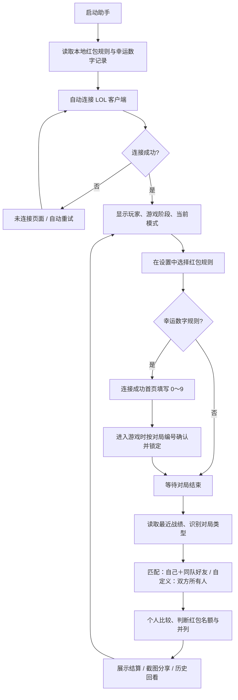

# 当前项目完整功能分析

审查日期：2026-10-28。范围：当前工作区代码、测试、官网、打包配置和预览文件；与原版基线 `e0171ed` 对比。当前已提交版本为 `d604558`，工作区仍有后续未提交修改。本报告描述工作区实际行为，不将预览画面视为真实客户端验证。

> 后续修复说明（2026-10-28）：下文为修复前审查记录。其中错局结算、开局切换矛盾和历史规则随设置变化的问题已在后续代码中处理；设置页下载地址已删除。最新行为与验证见 [结算与规则锁定修复说明](./结算与规则锁定修复说明.md)。其余风险未因本次修复自动消除。

> 2026-10-29 人数规则更新：匹配与自定义已采用不同红包名额，并支持开局锁定的自定义指定人数；本文以下人数表保留审查时旧规则，当前规则见 [红包人数规则](./红包人数规则.md)。

## 1. 整体定位与结论

项目是一个 Windows 桌面版 LOL 红包结算助手：连接本机英雄联盟客户端，读取游戏阶段、好友和战绩，筛选参与者，按规则确定需要发红包的人。

当前桌面端核心已从“伤害综合评分＋楼层组队”改为“自动识别对局类型＋个人伤害数字比较”。原版四页面结构、窗口布局、托盘、历史记录、截图与更新框架继续使用。

目前主要缺口有两类：结算数据与状态边界仍有问题；官网、更新源、品牌和发布配置尚未完成 fork 后的同步。它还不是一个完整独立发布的新版本。

## 2. 当前运行流程

- 启动不弹出规则向导，沿用原版流程，在设置中切换规则。
- 连接后约每次请求完成 3 秒再轮询；未连接为 5 秒，避免请求重叠。
- 能显示大厅、匹配中、确认对局、选英雄、进入游戏、游戏中、重连、结算等阶段。
- 当前使用轮询，没有通过 WebSocket 订阅游戏事件。
- 自动结算在 `EndOfGame` 阶段触发。若用户正在前台阅读设置、历史或其他结果页，会保留页面；窗口最小化或收进托盘时可显示新结算。这是继承的交互，不是每次都强制打断。
- 自动打开的结算页在新一局开始时收起；手动查看的历史详情保持不变。

## 3. 参与者与红包规则

### 自动分组

| 对局类型 | 参与者 | 比较方式 | 页面展示 |
|---|---|---|---|
| 匹配模式 | 自己＋同队好友 | 所有人按个人比较 | 每名玩家独立卡片 |
| 自定义模式 | 双方全部玩家，包括非好友 | 两队混合按个人比较 | 按蓝、红阵营分区 |
| 类型未知、必要阵营信息缺失 | 不推测参与者 | 不自动结算 | 提示异常并可重试 |

“匹配模式”目前是非自定义对局的业务分类，没有单独实现普通匹配、单双排、灵活排位等完整细分标签；部分界面以“匹配/排位”合并显示。

好友身份来自客户端好友列表，不是开局预组队名单。因此同队好友即使偶遇也会被纳入；对面的好友在匹配模式中不会被纳入。自定义阵营只影响展示，不算团队总分，也不以游戏胜负判定红包。

### 伤害尾数

- 使用精确的 **对英雄造成伤害** `totalDamageDealtToChampions`，不是含小兵、野怪的总伤害。
- 从个位开始比较，9 最大、0 最小；个位相同再比十位、百位及更高位，每位越大越靠前。
- 高位不足视为 0；完整数字相同仍并列。
- 比较使用原始整数，不使用界面格式化后的显示值。
- 承伤、经济、击杀、死亡、助攻均不再参与计算。

### 幸运数字

- 用户在连接成功首页填写一个 0～9 整数；只有选择该规则才显示数字卡片。
- 设置页面只选择规则，不配置数字。输入采用文本表单，不是下拉框。
- 前端输入与存储层双重校验；空值表示未填写，0 是有效数字。
- 赛前可修改；进入 `GameStart` 且取得有效对局编号后确认、锁定、保存。
- 若漏过 `GameStart`，从最近一次赛前观察到进入游戏不超过 15 秒时，也允许确认。中途启动通常只恢复既有记录。
- 确认时消耗待配置数字；下一局需要重新填写。若未能完成确认，对局离开游戏阶段时也会尝试清理未消耗配置。
- 排名比较个位与幸运数字的环形距离（0 与 9 相邻），距离小者靠前。距离相同就比较十位、百位等与同一幸运数字的环形距离，**不会直接采用 8 大于 6**。
- 高位不足按 0；所有位距离都相同则并列。使用普通绝对距离，不采用 0 与 9 相邻的环形距离。
- 数字记录按对局编号保存在本机。没有自动广播、好友同步或多人共同确认机制。

例：幸运数字 7，伤害 76 与 68 的个位距离都为 1；继续比较十位，7 距离 0，6 距离 1，因此 76 靠前。

### 发红包人数与并列

| 参与人数 | 需要发红包的人数 |
|---|---:|
| 0–1 人 | 不结算 |
| 2–3 人 | 最后 1 人 |
| 4–5 人 | 最后 2 人 |
| 6–10 人 | 最后 2 人 |

代码实际采用“4 人及以上取最后 2 人”，没有在评分函数中设置 10 人上限。

并列只有跨越红包名额边界时才需要人工处理。例如最后两人并列且有两个名额，两人都可确定；如果已有一名明确垫底，另两人并列争夺剩余一个名额，则提示待决定。当前没有内置抽签、投票或人工选择并保存结果的操作。

应用只告诉用户谁应发红包，不配置红包金额、不连接支付，也不会自动发送红包。

## 4. 全部页面与桌面功能

| 页面/功能 | 当前内容与行为 | 来源 |
|---|---|---|
| 未连接首页 | 自动连接、连接失败提示、管理员方式重开提示；恢复原版“选英雄前启动，以记录准确分队”文案 | 继承，文案按用户要求恢复 |
| 连接成功首页 | 玩家名、游戏阶段、自动识别模式、当前红包规则、上一局/历史/设置入口 | 原结构＋新增模式信息 |
| 幸运数字首页卡片 | 待填写、待确认、已确认、输入错误、无法补设等状态 | 新增 |
| 设置 | “红包规则”标题；伤害尾数/幸运数字两张选择卡；版本与关于信息 | 原布局＋替换规则 |
| 结算 | 模式、人数、红包人数、需要发红包的玩家、伤害/承伤/KDA、自身标识 | 原结构＋新算法 |
| 自定义结算 | 双方玩家、蓝红阵营、个人红包结果 | 新增 |
| 幸运数字结算 | 本局数字、锁定状态、个人名次、按规则排序 | 新增 |
| 异常结算 | 类型未知、人数不足、伤害非法、数字缺失、名额边界并列；支持重新读取 | 新增/扩展 |
| 历史列表 | 最近 20 局；模式、时间、时长；加载、空记录、失败重试 | 继承 |
| 历史详情 | 查看指定对局，返回原历史列表 | 继承＋新规则计算 |
| 截图分享 | 将结果生成 PNG，优先复制到剪贴板，失败时尝试下载，并显示反馈 | 继承 |
| 窗口与托盘 | 默认靠右上、页面高度调整、保留拖动位置、限制显示器工作区；关闭隐藏到托盘，菜单显示/退出 | 继承 |
| 自动更新 | 启动后延迟检查，更新提示、下载进度、安装重启及失败提示 | 继承，仍指向原项目 |

显示差异：幸运数字结果有名次标签并排序；伤害尾数结果目前沿用参与者顺序，虽然红包对象按新规则正确计算，但没有同样的完整排名展示。

当前仍是 4 个业务页面。`预览/全部页面/` 的 21 张图片是这 4 个页面的不同状态，不是 21 个页面，也不代表真实客户端已连接。预览目录被 Git 忽略，不包含在正常版本提交中。

## 5. 与原版逐项比较

| 功能 | 原版 `e0171ed` | 当前 |
|---|---|---|
| 默认评分 | 经典：伤害＋承伤÷2 | 伤害尾数逐位比较 |
| 其他规则 | 最低输出、简化 OP 评分 | 幸运数字逐位距离比较 |
| 4 人 | 可按选英雄楼层分为前 2/后 2，或个人模式 | 全部按个人比较 |
| 5 人 | 1–2 楼一组、3 楼单人、4–5 楼一组；单人补偿倍数 | 全部按个人比较 |
| 楼层采集 | 选英雄时抓取楼层，历史数据可能推测楼层 | 已移除 |
| 自定义 | 没有当前这种双方全员个人结算分支 | 两队所有人统一比较 |
| 红包名额 | 原规则按最低组/个人处理 | 按参与人数取最后 1 或 2 人 |
| 并列 | 原最低组标记遇到同分取首个 | 识别红包边界并列，不任意指定 |
| 数字状态 | 无 | 每局手动填写、进入游戏锁定、按对局保存 |
| 手动分组设置 | 有 4 人分组选择 | 已移除，自动识别类型 |
| 页面流程 | 首页、结算、历史、设置 | 保持原结构 |
| 桌面基础设施 | 自动连接、轮询、托盘、截图、更新 | 继续使用 |

原版经典模式单人补偿为 `2×伤害＋承伤`；原版最低输出按原始伤害比较。原版简化 OP 结合伤害、承伤、经济相对队内均值与 KDA，再限制到 0～10。上述计算均已退出当前桌面评分路径。

已删除旧 `src/rules.ts`，拆为 `grouping.ts`、`scoring.ts`、`lucky.ts`。楼层捕获命令、经典/最低输出/OP 选项、手动分组入口也已移除。源码中的 `Math.floor` 现在用于伤害逐位运算，不代表旧楼层逻辑仍存在。

## 6. 仍保留的旧版内容

| 位置 | 残留 | 影响 |
|---|---|---|
| 官网 `website/index.html` | 原评分介绍、楼层分组教程、旧结算示例 | 官网描述与新桌面行为不一致 |
| 官网下载配置 | 原作者 GitHub 地址、原版 0.1.2 下载元数据 | 可能下载到原版安装包 |
| `website/latest.json` | 原版 0.1.0 更新清单 | 不是当前 fork 的新版更新清单 |
| `tauri.conf.json` | 原站点和 `paidaxn/aram-helper` 更新源、原公钥 | fork 尚无独立更新通道；未来可能收到原版更新提示 |
| 程序身份 | `com.paidaxn.aram-helper`、原作者信息、版本 0.1.2、原图标 | 新旧版本身份区分不清晰，未完成独立发行配置 |
| 关于与截图水印 | `daguagua.top` | 仍引导至原站点 |
| `RELEASE.md` | 原评分、原发布记录和旧验证结果 | 不能作为当前版本已验证的证明 |
| 未连接提示 | “选英雄前启动，以记录准确分队” | 按用户要求恢复，但楼层采集已移除，技术含义已过时 |
| 内部命名/注释 | `solo`、`LuckyDraw`、“补抽”等 | 命名遗留，不代表仍随机抽数或手动分组 |
| 数据字段 | `goldEarned`、`championId` 等仍采集 | 不再用于评分，部分也未用于当前界面 |

官网仍包含 Microsoft Clarity 埋点及页面/下载相关事件；桌面源码中未发现同样的 Clarity 接入。官网是单独的一部分，桌面改动没有自动同步它。

## 7. 数据、接口与存储

前端 Vue 3/TypeScript 负责展示、规则和页面控制；Tauri 2/Rust 连接本机 LCU，读取原始数据并缓存。Vite 负责前端构建。

| 数据 | 当前来源/处理 |
|---|---|
| 客户端凭据 | Windows 进程信息、PowerShell/CIM、可执行路径附近 lockfile 等途径 |
| 召唤师 | `/lol-summoner/v1/current-summoner` |
| 游戏阶段 | `/lol-gameflow/v1/gameflow-phase` |
| 当前对局编号及类型 | `/lol-gameflow/v1/session` |
| 好友 | `/lol-chat/v1/friends` |
| 历史列表与详情 | `/lol-match-history/v1/` 下的列表和对局详情接口 |
| 历史类型补充判断 | `gameType`，缺失时查询 `/lol-game-queues/v1/queues/{id}/isCustom` |

连接使用本机 HTTPS 与客户端凭据，没有调用需要申请 Riot API Key 的公网接口来完成上述结算。当前代码只读这些游戏接口，不进行自动选英雄、接受对局或操作游戏。

存储分三部分：

1. `localStorage.scoringMode`：当前全局红包规则。
2. `localStorage.luckyState`：版本 4 的待配置数字与按 gameId 保存的确认记录，包含旧存储格式迁移。
3. 应用数据目录的 `game_history.json`：以 gameId 为键保存对局数据，历史详情优先读缓存，旧格式缺少类型/阵营时尝试重取。

当前没有账号登录系统、云同步、房间共享、完整离线历史列表、数据导入导出、记录清理界面或长期统计排行榜。历史入口仍依赖 LCU 拉取列表。数字和战绩缓存没有自动容量清理策略。

## 8. 已确认问题与待验证风险

下列内容区分了本地复现、代码确认和未验证行为。本次只分析，没有修改业务实现。

### 优先修复：结算正确性

**A. 最近战绩滞后可能展示错局（已用控制器模拟复现）。**

实际进入对局 101，结束时战绩接口暂时返回上一局 100，当前控制器会打开 100 的结果并标记已处理。它只避免与上一次自动展示的编号重复，没有核对本次真正结束的对局编号。可能导致本局结果不再自动刷新。

定位：`src/assistant.ts` 的 EndOfGame 分支、`src-tauri/src/lcu.rs` 的 `get_last_game_result`。应保留待结算 gameId，按本局编号读取或等待匹配，不能仅取列表第一项。

**B. 缺失伤害被转换成 0（代码确认）。**

后端读取 `totalDamageDealtToChampions` 使用 `as_i64().unwrap_or(0)`。字段缺失、类型错误或不可解析时都会得到合法的 0，前端整数校验无法识别缺失数据，可能将不完整结果用于红包判断。应区分“真实零伤害”和“未取得数据”。

定位：`src-tauri/src/lcu.rs:351`。

**C. 好友接口失败被当作没有好友（代码确认）。**

好友读取失败会返回空集合。匹配模式通常因此只剩自己并提示人数不足，而不是明确提示好友读取失败；结果仍可能写入缓存，之后查看该详情可能继续采用不完整好友标记。

定位：`src-tauri/src/lcu.rs:248`、`src-tauri/src/lib.rs:55`。

**D. 历史缓存没有账号隔离（代码确认，跨账号场景未实测）。**

缓存仅按 gameId 区分，内容却包含依赖账号的 `isMe/isFriend`。例如同机换到同局另一位玩家账号，再读该局缓存，会有复用前账号身份和好友标记的风险。缓存命中发生在当前账号确认之前。

同时，首次读取旧战绩使用的是当时查询到的现有好友列表，并不保证等同于开局时好友关系；缓存后又不会持续刷新。这会影响匹配参与者的可追溯性。

定位：`src-tauri/src/lib.rs:112` 附近。

### 规则生命周期

**E. 开局切换规则的提示与实际行为矛盾（已用控制器模拟复现）。**

在伤害尾数规则下进入 GameStart，再切换幸运数字，界面提示“本局不能补设”；但若已有待配置数字，下一次轮询仍可确认到本局。需要统一“进入游戏后是否允许切换规则”的产品约束及实现。

定位：`src/assistant.ts` 的 `selectScoringRule` 和 `poll`。

**F. 历史结果使用当前全局规则重新计算（实现行为，需明确预期）。**

当前只保存每局幸运数字，没有保存每局采用的红包规则。切换设置会改变同一历史数据的计算方式；切到幸运数字时，旧局没有对应数字就无法按该规则结算。示例伤害 `[0,7,9]`：尾数规则由 0 发；幸运数字为 0 时由 9 发。这不是排序函数错误，而是缺少每局规则快照。

**G. “每局重新填写”依赖观察到对局生命周期（代码边界，未真实断电验证）。**

正常确认会原子保存记录并清空待配置数字；但用于清理“没成功确认的旧配置”的 `enteredGame` 标记只存在内存。如果开局确认失败后退出或崩溃，再在赛前重启，仍需验证旧待配置数字能否被错误保留。

### 存储、显示与实机验证

- 战绩缓存写入失败被忽略，整文件写入不是原子替换；可能无提示地丢失缓存。已有 JSON 读取失败也被当作空缓存。
- 幸运数字记录是本机可修改数据，不是多人共同验证的对局凭证。当前用户手动规则可用，但不能宣称有防篡改或共享公示能力。
- 自定义依赖 LCU 历史接口提供该局记录、完整双方参与者和正确类型，需要 Windows 实际自定义对局验证；尚未接入独立结算统计接口作为兜底。
- 当前后端凭据发现仅实现 Windows。macOS 浏览器可以看预览，但不能因此认为 macOS 原生游戏连接已支持。
- 伤害尾数页与幸运数字页的排名展示不统一；这是 UI 完整性问题，不是已确认的算分错误。

### 发布阻碍

- 更新源、官网、下载包、版本号和应用身份仍是原项目；新功能发布前需要统一。
- 更新源未迁移意味着将来可能提示原版升级，不代表当前已经覆盖程序；仓库内旧清单版本也不能证明远端此刻返回什么。
- Windows 工作流仅手动触发，执行测试、前端构建、Rust 测试及 NSIS 打包，关闭更新产物生成，上传保留 14 天的安装包构建产物。它不自动创建 GitHub Release，也不自动发布官网或签名更新清单。

## 9. 验证与同步状态

- 本次审查执行 `npm test`：**77 项通过，0 失败**。覆盖页面轮询、分组、评分、幸运数字和官网下载/构建相关逻辑。
- 前一轮界面修改后前端类型检查与生产构建已通过；本轮分析未改动业务代码。
- 额外控制器模拟已复现“错局自动展示”和“GameStart 切换规则仍确认数字”；它们不在当前通过的回归测试保护范围内。
- 本机未取得 Rust 编译验证结果，也没有在本轮完成 Windows 安装、真实 LCU、自定义对局、系统托盘或原生剪贴板端到端测试。
- 当前已提交版本 `d604558`；分析开始时工作区有 **11 个业务/测试文件未提交修改**，最近界面与规则调整仍在本地。本报告会另外新增一个文档文件。
- 本地 `origin/master` 跟踪信息与 HEAD 一致，本轮未重新获取远端，不据此断言 GitHub 实时内容。此前推送成功也不等于当前未提交修改已经同步。

## 10. 建议实施顺序

1. 先保证结算正确：绑定本局编号，阻止不完整伤害和好友数据进入缓存/计算，隔离账号缓存。
2. 固定规则生命周期：保存每局规则快照，统一开局切换边界，补齐断线/重启后待配置数字的处理。
3. 做 Windows 实局验收：匹配 3/5 人、自定义双方全员、未填数字、正常锁定、跨名额并列、战绩延迟、重连和换号。
4. 完成独立发行配置：版本、应用身份、更新源、公钥、官网规则与下载入口；生成并验证属于当前 fork 的安装包。
5. 再完善展示：尾数模式排名、并列人工处理、历史中明确显示当局规则。金额、支付、共享房间等属于尚未要求的新功能，应另行确定范围。

## 代码入口

- [页面与展示逻辑](../src/App.vue)
- [连接轮询与对局生命周期](../src/assistant.ts)
- [参与者筛选和阵营展示](../src/grouping.ts)
- [评分与红包名额](../src/scoring.ts)
- [幸运数字记录](../src/lucky.ts)
- [LCU 数据读取](../src-tauri/src/lcu.rs)
- [本地缓存与桌面命令](../src-tauri/src/lib.rs)
- [应用和自动更新配置](../src-tauri/tauri.conf.json)
- [原版官网](../website/index.html)
- [Windows 构建工作流](../.github/workflows/windows-build.yml)
